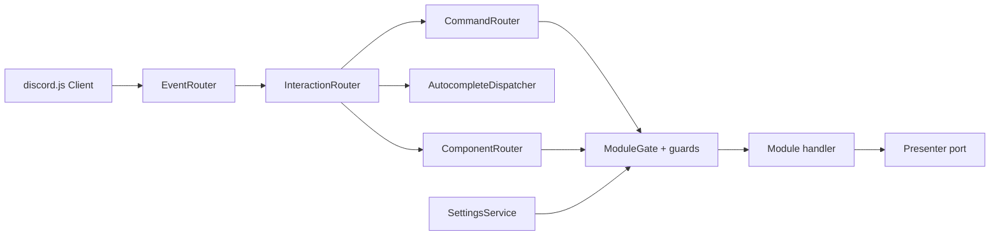

<div align="center">

<h1>discord-kernel</h1>

<p>Framework kernel for Clean Architecture Discord bots built on discord.js.</p>

[](https://github.com/Azurioh/discord-kernel/actions/workflows/ci.yml)
[](https://www.npmjs.com/package/@azurioh/discord-kernel)
[](LICENSE)
[](https://www.typescriptlang.org/)
[](https://nodejs.org/)

</div>

pnpm workspace of the discord-kernel libraries, versioned with Changesets.

## Why

Every bot ends up rebuilding the same plumbing: a command DSL, guards, interaction routing,
paginated screens, localisation, per-guild settings. `discord-kernel` ships that plumbing once,
as the innermost ring of a Clean Architecture bot. It knows discord.js and nothing else: no
database, no logger implementation, no opinion about what your bot does. Being a package
rather than a folder is what keeps outer rings out of its dependency graph.

## Features

- **Command DSL**: `createCommand` (flat or grouped), typed options, autocomplete, context menu commands.
- **Guards**: `allOf` / `anyOf`, permissions, roles, cooldowns, `requireLevel`, `requireConfigured`.
- **Routing**: `CommandRouter`, `ComponentRouter` for persistent `customId`s, `EventRouter` as the one place `client.on` is called.
- **Components**: collector-backed `paginator`, `interactive-message` and `settings-editor` screens, typed buttons, modals and select menus.
- **i18n**: catalogs (`en` mandatory, `fr` optional), a registry that fails the boot on a duplicate key, per-guild locale resolution.
- **Module settings**: declared once with `defineSettings`, then validated, stored, cached, migrated, and rendered as a Discord settings screen, autocomplete suggestions and a JSON Schema.
- **Module gate**: a module disabled on a guild has its commands, components and events skipped there.
- **Ports**: `Logger`, `DatabaseConnection`, `Presenter`, `Clock`, `ChannelExporter`, `Authorizer`, `Scheduler` (node-cron implementation included), `SettingsStore` with a runner-agnostic contract suite.

## Install

```bash
pnpm add @azurioh/discord-kernel discord.js
```

`discord.js` (14.27+) is a peer dependency: two copies in one tree would break every
`instanceof` the gateway relies on. Requires Node 22.12+.

## Usage

Every path is imported directly; there is no root barrel. A minimal module and its wiring:

```ts
import { createCommand } from "@azurioh/discord-kernel/discord/command/create-command";
import { CommandRouter } from "@azurioh/discord-kernel/discord/command/router";
import { createEvent } from "@azurioh/discord-kernel/discord/events/create-event";
import { EventRouter } from "@azurioh/discord-kernel/discord/events/event-router";
import { CORE_CATALOG } from "@azurioh/discord-kernel/discord/i18n";
import { InteractionRouter } from "@azurioh/discord-kernel/discord/interaction/interaction-router";
import { TranslationRegistry } from "@azurioh/discord-kernel/i18n/catalog";
import { createTranslator } from "@azurioh/discord-kernel/i18n/translator";
import type { BotModule } from "@azurioh/discord-kernel/module/module";
import { Client, GatewayIntentBits } from "discord.js";

const basics: BotModule = {
  name: "basics",
  commands: [
    createCommand({
      name: "ping",
      description: "Check the gateway latency",
      handler: (ctx) => ctx.confirm(`Pong: ${ctx.interaction.client.ws.ping} ms`),
    }),
  ],
};

// `logger` and `presenter` are your implementations of the Logger and Presenter ports.
const translations = new TranslationRegistry();
translations.register(CORE_CATALOG);
const translator = createTranslator(translations, { defaultLocale: "en", logger });

const client = new Client({ intents: [GatewayIntentBits.Guilds] });
const commands = new CommandRouter({ presenter, logger, translator });
commands.registerAll(basics.commands ?? [], basics.name);
const interactions = new InteractionRouter([commands]);

new EventRouter(logger)
  .register(createEvent({ name: "interactionCreate", execute: (i) => interactions.dispatch(i) }))
  .bind(client);

await commands.deployCommands(token, clientId);
await client.login(token);
```

Settings, the settings store contract, theming and per-guild values are documented in the
[kernel README](packages/kernel/README.md). [`apps/sandbox-bot`](apps/sandbox-bot/README.md) is a
complete composition root.

## How it works



The application's composition root builds the kernel services, collects each `BotModule`'s
catalogs, settings, commands and events, and binds them to one client. Replies go through the
`Presenter` port, in the language picked by a `LocaleResolver`.

## Packages

| Package | Description | Version |
| ------- | ----------- | ------- |
| [`@azurioh/discord-kernel`](packages/kernel/README.md) | Command DSL, guards, routing, components, i18n, settings and ports | [](https://www.npmjs.com/package/@azurioh/discord-kernel) |
| [`sandbox-bot`](apps/sandbox-bot/README.md) | Private bot exercising the kernel on a test guild, never published | private |

Architecture, planned packages and feature specs: [`docs/roadmap.md`](docs/roadmap.md).
Principles every package follows: [`.specify/memory/constitution.md`](.specify/memory/constitution.md).

## Development

```bash
pnpm install
pnpm lint && pnpm typecheck && pnpm knip && pnpm test && pnpm build
```

Every script runs across the whole workspace from the repository root, in the same order as CI.

| Script | Runs |
| ------ | ---- |
| `pnpm build` | `build` in every package |
| `pnpm typecheck` | `typecheck` in every package |
| `pnpm lint` | `biome ci --error-on-warnings` |
| `pnpm format` | `biome check --write` |
| `pnpm knip` | Unused files, exports and dependencies |
| `pnpm test` | `test` (Vitest) in every package |

Releases use [Changesets](https://github.com/changesets/changesets): add a changeset with
`pnpm changeset` in any PR that changes a published package, then `pnpm changeset version`
bumps versions and changelogs, and `pnpm changeset publish` publishes to npm.

## Contributing

Issues and pull requests are welcome. Run the full check chain above before opening a PR.

## License

[MIT](LICENSE)
