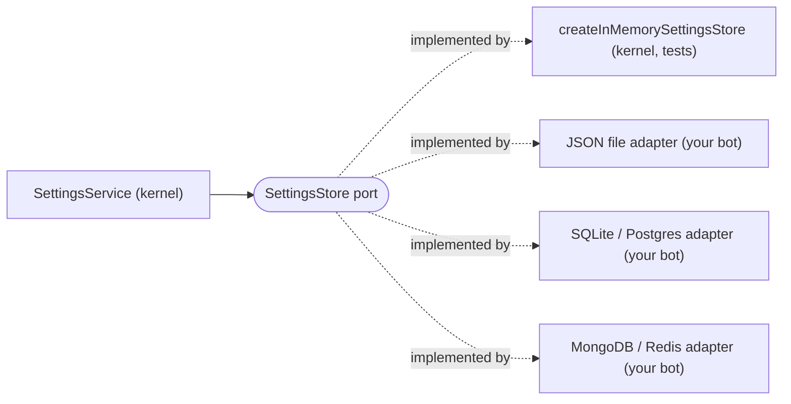

# @azurioh/discord-kernel

The framework half of a Discord bot, without the bot: a command DSL, guards,
interaction routing, composed components, localisation, and the ports an
application implements. It knows discord.js and nothing else — no database, no
logger implementation, no opinion about what your bot does.

Built for Clean Architecture with vertically-sliced feature modules: the kernel
is the innermost ring, and the fact that it is a package rather than a folder is
what enforces that — an outer ring simply is not in its dependency graph.

```bash
pnpm add @azurioh/discord-kernel discord.js
```

`discord.js` is a **peer dependency**, never a dependency: two copies of the
library in one tree would break every `instanceof` the gateway relies on.

## What is in it

| Area | What it gives you |
| ---- | ----------------- |
| `bot/` | `createBot`: shared services, module assembly, ordered startup and shutdown, interaction routing and command deployment |
| `discord/command/` | `createCommand` (flat or grouped), typed options, guards (`allOf`/`anyOf`, permissions, roles, cooldowns), the per-interaction `Context`, autocomplete, the `CommandRouter` |
| `discord/interaction/` | `createButton`, `createModal`, the four typed select menus (`createStringSelect`, `createChannelSelect`, `createRoleSelect`, `createUserSelect`), the `InteractionRouter`/`InteractionDispatcher` seam |
| `discord/components/` | `ComponentRouter` for persistent `customId` routing, and collector-backed screens: `paginator`, `interactive-message`, `settings-editor` |
| `discord/events/` | `createEvent` and the `EventRouter` — the one place `client.on` is called |
| `discord/ui/` | Embeds with Discord's size limits handled, `createCard` containers, a configurable palette, a colour-input parser |
| `i18n/` | Catalogs (`{ en, fr? }`, `en` mandatory), a registry that fails the boot on a duplicate key, per-interaction locale resolution |
| `authz/` | An `Authorizer` port with `viewer`/`editor` grants, a `requireLevel` guard, an in-memory authorizer and its contract suite (`authz/testing`) |
| `errors/` | `BusinessError` and friends, carrying an optional translation key beside the English source |
| `scheduler/` | A `Scheduler` port, a node-cron implementation and an in-memory twin |
| Ports | `Logger`, `Clock`, `DatabaseConnection`, `MigrationRunner`, `Authorizer`, `Scheduler`, `ChannelExporter`, `Presenter`, `LocaleResolver`, `ModuleGate`, `ModuleAvailability`, `ProcessLike`, and the settings ports — declared here (tagged `@port`), implemented by your app, each with an [in-memory twin](#testing-with-in-memory-twins) |

Every path is imported directly; there is no root barrel:

```ts
import { createCommand } from "@azurioh/discord-kernel/discord/command/create-command";
import type { Logger } from "@azurioh/discord-kernel/logger";
import { type Catalog, createTranslator } from "@azurioh/discord-kernel/i18n";
```

## What is deliberately not in it

- **A database.** `DatabaseConnection` is a lifecycle port — connect, close — and
  nothing more. Query APIs differ too much between engines to abstract usefully,
  so an adapter exposes its own and your repositories are the only code that
  touches it.
- **A logger.** `Logger` is a port; pino, Sentry or `console` live in your app.
- **A configuration shape.** The kernel ships env-reading primitives
  (`requireEnv`, `enumEnv`, …); which keys exist is your composition root's call.
- **A palette.** Embeds render in Discord's blurple until you say otherwise, so a
  bot never starts out wearing someone else's identity.

## Starting a bot

`createBot` takes your modules, a `Logger` and a `SettingsStore`. It registers
catalogs, validates declarations, builds the shared services and wires slash
commands, context menus, autocomplete, components and gateway events. Existing
routers and services remain available through their public entry points for
custom assembly; settings stay under `settings` and `settings/testing`.

Use `build(context)` for parts that need the finished settings service,
translator, registry, gate, presenter, clock or client. Its logger carries
`{ module: name }`. A part belongs either on the module or in its build result;
declaring it in both places fails creation.

Modules are gated by their per-guild toggle by default. Set `gated: false` for
administration commands that must answer independently of guild toggles. Module
ownership is preserved: an unavailable optional module cannot run handlers,
even when it is ungated.

This executable smoke example uses the same start → serve → stop flow as
`tests/bot/minimal-bot.test.ts`, with in-memory adapters and shared test helpers.
The fake client never connects to Discord. In an application, supply durable
storage and your logger, use the real client and `await bot.start(token)`, and let
gateway interactions reach the registered handlers.

```ts
import { createBot } from "@azurioh/discord-kernel/bot/create-bot";
import { createInMemoryProcess } from "@azurioh/discord-kernel/bot/in-memory-process";
import { createCommand } from "@azurioh/discord-kernel/discord/command/create-command";
import { createInMemoryLogger } from "@azurioh/discord-kernel/in-memory-logger";
import { createInMemoryScheduler } from "@azurioh/discord-kernel/scheduler/in-memory-scheduler";
import { createInMemorySettingsStore } from "@azurioh/discord-kernel/settings";
import { createBotInteraction, dispatchClientEvent, startFakeBot } from "./tests/support/bot-interaction";
import { createFakeClient } from "./tests/support/fake-client";

const ping = {
  name: "ping",
  commands: [createCommand({
    name: "ping",
    description: "Check availability",
    async handler(context) {
      await context.confirm("Pong");
    },
  })],
};

const bot = createBot({
  modules: [ping],
  logger: createInMemoryLogger(),
  settingsStore: createInMemorySettingsStore(),
  discord: { client: createFakeClient() },
  adapters: { scheduler: createInMemoryScheduler() },
  lifecycle: { process: createInMemoryProcess() },
});
await startFakeBot({ bot });
const interaction = createBotInteraction({ kind: "slash", name: "ping", guildId: "100000000000000001" });
await dispatchClientEvent({ client: bot.client, event: "interactionCreate", args: [interaction] });
await bot.stop();
```

`deployCommands({ token, clientId })` returns the number of slash and context-menu
commands deployed, with one request per target scope. It performs no gateway login,
database connection, migration or module setup and can run in a separate deployment
script. Pass `rest: createInMemoryDeployRest()` (from
`discord/command/in-memory-deploy-rest`) to inspect payloads in tests.

Default presentation and guild language resolution are provided; override them
through `adapters.presenter` and `adapters.localeResolver(services)`.

### Lifecycle

`bot.state` moves through `created → starting → running → stopping → stopped`.
`start(token)` connects databases in declaration order, runs migrations, installs
the readiness listener before logging in, awaits `clientReady`, runs module setup
in declaration order, then starts the available modules' jobs. Without an injected
scheduler, it uses `CronScheduler`. Each step logs its name, duration and optional
target through the logger.

A required startup failure stops acquired resources and rejects `start()` with the
original error. An `optional: true` module whose setup fails becomes unavailable:
its jobs and every owned command, context menu, component, event and autocomplete
handler are skipped, independently of `gated`. Autocomplete answers with an empty
list. Modules without setup become ready too.

`stop()` shares one promise and returns a `StopReport` with `ok`, `reason`, `failed`
and `abandoned` (and `signal` for a signal stop). It waits for any active startup
step, stops jobs, tears down ready modules in reverse declaration order, closes
connected databases in reverse connection order, destroys the client if login was
called, then runs named `lifecycle.flushes` in declaration order. Unavailable
modules are never torn down; pending modules wait for successful setup. Finally it
releases the settings notifier subscription and process handlers, including after
failed startup or a stop before
startup. Step failures are recorded and later cleanup still runs. Flush failures
use `process.stderr` because the logger may already be closed.

One global shutdown deadline defaults to 10 seconds; override it through
`lifecycle.shutdownTimeoutMs`. An overdue step is listed in `abandoned`; all
remaining steps share one additional 1-second grace period. Total shutdown time is
bounded by the configured timeout plus that single grace period, even when several
steps hang. `ok` is false for any failed or abandoned step.

Calling `stop()` during `starting` interrupts startup between steps. A pending
step may settle, but no remaining startup steps run, no later jobs are scheduled
and the bot cannot become `running`. Shutdown releases what startup acquired.
If an abandoned startup step succeeds later, its resource is released through the
same cleanup path, using the original deadline and grace period. A late successful
module setup is torn down without becoming ready. Before closing databases or the
client, shutdown joins pending startup and its cleanup until the absolute grace
deadline; `start.settle` remains reported as abandoned. Resources acquired after
shutdown are released best-effort and logged. Late cleanup failures or abandonments
are logged and appended to the report.
The interrupted `start()` resolves after cleanup; an actual startup failure still
rejects with its original error.

By default, `SIGINT` and `SIGTERM` request one stop with reason `signal`, then exit
with 0 on success or 1 when cleanup fails or abandons a step. Crashes from
`uncaughtException` or `unhandledRejection` are logged once at `fatal`, stop with
reason `crash`, then exit with 1. A crash during a signal stop retains one stop and
one exit, with exit code 1. Programmatic `stop()` does not exit the process.
Disable handlers with `lifecycle.handleSignals: false` or
`lifecycle.handleCrashes: false`, and inject `lifecycle.process` for tests.

Outside `running`, interactions receive an ephemeral denial in the resolved locale
using `CORE_MESSAGES.botRestarting` (`core.lifecycle.restarting`); autocomplete
receives an empty list. Unavailable-module replies use
`CORE_MESSAGES.moduleUnavailable` (`core.lifecycle.module-unavailable`). Both keys
are supplied in English and French by `CORE_CATALOG`.

## Module settings

A module declares its per-guild settings once. The kernel then validates,
stores, caches and reads them, and builds the Discord settings screen, the
autocomplete suggestions and a JSON Schema for other surfaces (a web
dashboard) from that single declaration. Everything lives behind two entry
points: `@azurioh/discord-kernel/settings` and, for tests,
`@azurioh/discord-kernel/settings/testing`.

### Declaring settings

Every text is a catalog key (with an English source), never a literal:

```ts
import { defineSettings, field } from "@azurioh/discord-kernel/settings";

export const tickets = defineSettings({
  id: "tickets",
  version: 1,
  labels: { title: "tickets.settings.title" },
  groups: { routing: { label: "tickets.settings.routing" } },
  fields: {
    channel: field.channel({ label: "tickets.channel", types: ["text"], required: true, ui: { group: "routing" } }),
    staffRole: field.role({ label: "tickets.staff-role", ui: { group: "routing" } }),
    maxOpen: field.integer({ label: "tickets.max-open", min: 1, max: 10, default: 3 }),
    cooldown: field.duration({ label: "tickets.cooldown", default: 300 }), // seconds, typed as `5m`
    mode: field.enum({
      label: "tickets.mode",
      choices: [
        { value: "open", label: "tickets.mode.open" },
        { value: "closed", label: "tickets.mode.closed" },
      ],
      default: "open",
    }),
    apiKey: field.secret({ label: "tickets.api-key" }),
    pingRoles: field.list(field.role(), { label: "tickets.ping-roles", maxItems: 5, default: [] }),
  },
});
```

Field kinds: `text`, `integer`, `number`, `boolean`, `enum`, `color`,
`duration`, `channel`, `role`, `user`, `secret`, `list` and `toggles`. Give the
declarations to a `BotModule` (`settings: [tickets]`), then build the registry
and the service once, in the composition root:

```ts
import { createDiscordGuildDirectory } from "@azurioh/discord-kernel/discord/settings/discord-guild-directory";
import {
  createInProcessNotifier,
  createSettingsRegistry,
  createSettingsService,
  SETTINGS_CATALOG,
} from "@azurioh/discord-kernel/settings";

translations.register(SETTINGS_CATALOG); // with CORE_CATALOG and every module's catalog
const registry = createSettingsRegistry({
  declarations: modules.flatMap((module) => module.settings ?? []),
  translations, // a key without an English source fails the boot, as does a duplicate id
  modules, // builds the module toggles, see "System settings"
});
const settings = createSettingsService({
  registry,
  store, // your SettingsStore adapter, see "Storage adapters"
  guilds: createDiscordGuildDirectory(client),
  notifier: createInProcessNotifier(logger),
  translator,
  clock: systemClock,
  logger,
});
```

### Reading and writing

Values are typed from the declaration: a required field or a field with a
default is never `undefined`, a mistyped key fails to compile.

```ts
const values = await settings.get(tickets, guildId); // cached; defaults for unset fields
values.maxOpen; // number
values.staffRole; // string | undefined

const ctx = { guildId, userId, locale }; // who writes, where, in which language
await settings.validate(tickets, guildId, { maxOpen: 50 }, ctx); // { ok: false, issues: [{ field: "maxOpen", code: "max", ... }] }
await settings.set(tickets, guildId, { maxOpen: 5, staffRole: null }, ctx); // null unsets a field
await settings.reset(tickets, guildId, ["maxOpen"], ctx); // or "all"
const { missing } = await settings.status(tickets, guildId); // required fields left unset
```

`set` stores nothing unless every submitted field is valid, and throws a
`SettingsValidationError` listing all the issues. Two writers holding the same
`expectedRevision` cannot both win: the second gets a `ConflictError`. Every
write invalidates the cache and emits a `settings.changed` event through the
notifier. Module logic reads secrets with `get`; surfaces use `getForSurface`,
where a secret is only `{ isSet }`.

### The Discord settings screen

`settingsEditorFromDeclaration` turns a declaration into the options of
`mountSettingsEditor`: one control per field kind, groups split into modals of
at most 5 inputs, nested levels so a card never exceeds Discord's component
budget, and every save sent through `service.set`, so the screen accepts and
refuses exactly what the service does.

```ts
import {
  editorComponentIds,
  mountSettingsEditor,
  settingsEditorFromDeclaration,
} from "@azurioh/discord-kernel/discord/components/settings-editor";

const adapted = await settingsEditorFromDeclaration(tickets, settings, {
  guildId,
  userId,
  locale: ctx.locale,
  translator,
});
await mountSettingsEditor(ctx.interaction, {
  ...adapted,
  ids: editorComponentIds("tickets-settings"),
  chrome, // your title and colours
  translator,
  locale: ctx.locale,
  clock: systemClock,
  logger,
});
```

### Describing settings for other surfaces

`settings.describe(declaration, locale)` returns a JSON Schema (draft 2020-12)
with every label and description translated (English for an unsupported
locale), and kernel hints (kind, group, order, secret) under `x-kernel`. A
secret's value is never in it. A web dashboard renders its form from this and
writes through the same `set`.

### Suggestions and strict fields

A field can offer suggestions, static or searched:

```ts
timezone: field.text({
  label: "tickets.timezone",
  suggest: { resolve: searchTimezones, label: timezoneLabel, strict: true },
}),
```

`settings.suggest(declaration, key, query, { ...ctx, values })` returns at most
25 `Choice`s in the command autocomplete's own format, so one search serves
`/config set` and the settings screen (where a searchable field becomes a
select). Channel, role and user fields search the guild without any code. A
search slower than 2.5 s (`SUGGESTION_TIMEOUT_MS`) or failing yields nothing
and is logged. `settings.label(...)` gives a stored value's readable name. A
**strict** field accepts only a value its search knows; anything else is an
`unknownChoice` issue.

### System settings: module toggles and guild language

The kernel declares its own settings like any module (`registry.kernel`): which
modules are enabled on the guild (`defaultEnabled` on a `BotModule`, `true`
unless said otherwise) and the bot's language there. Pass a `ModuleGate` to the
routers and each gated handler is skipped on a guild that disabled its module,
with a translated reply for commands and components:

```ts
import { createModuleGate } from "@azurioh/discord-kernel/settings";

const gate = createModuleGate({ service: settings, registry, logger });
const commands = new CommandRouter({ presenter, logger, translator, gate, localeResolver });
const components = new ComponentRouter({ presenter, logger, translator, gate, localeResolver });
const events = new EventRouter(logger, gate);
commands.registerAll(module.commands ?? [], module.name); // no name: never gated
```

Scheduled jobs call `gate.isEnabled(moduleName, guildId)` themselves. The guild
language reaches every reply through the `LocaleResolver` port, described in
[Per-guild values](#per-guild-values).

### Blocking a command until its module is configured

`requireConfigured(declaration, service)` is a guard for a command or a
component handler. It denies while a required field is unset, and lets the call
through as soon as it is set, without a restart. Members with *Manage Server*
also read which settings are missing.

```ts
import { requireConfigured } from "@azurioh/discord-kernel/discord/settings/require-configured";

createCommand({ name: "ticket", guard: requireConfigured(tickets, settings), handler });
```

### Evolving module settings

Adding a field needs nothing: guilds configured before read its default.
Removing one needs nothing either: its stored value is ignored and dropped on
the next write. To reshape stored values (rename a key, change a unit), raise
the declaration's `version` and give it a `migrate`:

```ts
export const warnings = defineSettings({
  id: "warnings",
  version: 2, // was 1: `maxWarnings` became `warnLimit`
  migrate: (fromVersion, raw) => {
    if (fromVersion !== 1) throw new Error(`no migration from version ${fromVersion}`);
    const { maxWarnings, ...rest } = raw as Record<string, unknown>;
    return maxWarnings === undefined ? rest : { ...rest, warnLimit: maxWarnings };
  },
  labels: { title: "warnings.title" },
  fields: { warnLimit: field.integer({ label: "warnings.limit", min: 1, max: 10, default: 3 }) },
});
```

Migration is lazy: the first read of a guild's older record runs `migrate`,
validates the result like any stored value, and writes it back once under the
new version (a concurrent reader on another shard loses the compare-and-set and
simply reads the migrated record). `set` and `reset` migrate first too. Rules for
`migrate`:

- **Pure.** It receives a copy of the stored values and returns the new ones;
  no I/O, no clock, no randomness.
- **Every older version.** A guild may skip releases, so `fromVersion` can be
  any version below the current one. Chain the steps (v1 → v2 → v3) or throw
  for a version you no longer support.
- **Failures are safe.** When it throws or its result fails validation, nothing
  is written, the error is logged with the guild, module and versions, and the
  guild reads defaults for the fields it cannot read. A record written by a
  newer version (after a rollback) is read but never overwritten.

### Storage adapters

Settings persistence is hexagonal: the kernel declares the `SettingsStore` port
and never imports a database driver. Each database sits behind an adapter your
bot owns, and the composition root picks one at boot.



The port has three methods: `read`, `write` and `delete`. It stores one
`StoredSettings` record per `(guildId, moduleId)`, and every field of a record
is JSON-serialisable. An adapter must honour these guarantees:

| Guarantee | Meaning |
| --------- | ------- |
| A missing record reads as `null` | `read` returns `null` until the first write and after a delete |
| Atomic compare-and-set | `write` lands only if the stored revision equals `expectedRevision` (`null` means no record yet), checked and applied in one atomic step, so of two writers holding the same revision exactly one wins |
| Conflicts change nothing | A mismatch throws the kernel's `ConflictError` and leaves the stored record as it was. Any other failure is thrown as it is, never as a conflict |
| Isolation | One `(guildId, moduleId)` never reads, overwrites or deletes another |
| Idempotent delete | Deleting a missing record succeeds |
| Independent copies | The store keeps no reference to the record it was given and hands out none it keeps |
| Faithful round-trip | `read` returns a record equal to the one written (JSON values, `updatedBy` absent stays absent) |

#### Writing an adapter for any database

The only hard part is the compare-and-set. Use the native primitive that checks
and writes in one step, never a read followed by a write:

- **SQL (Postgres, MySQL, SQLite):** a table keyed `(guild_id, module_id)`. A create
  is `INSERT ... ON CONFLICT DO NOTHING` and an update is
  `UPDATE ... WHERE guild_id = ? AND module_id = ? AND revision = ?`. Zero affected
  rows means `ConflictError`. The sandbox bot's `src/shared/settings/sqlite/` is a
  worked example.
- **MongoDB:** one document per key with a unique index on `{ guildId, moduleId }`.
  An update is `findOneAndUpdate({ guildId, moduleId, revision: expected }, { $set: record })`,
  where no match means a conflict. A create is `insertOne`, where a duplicate-key error
  (code 11000) means a conflict.
- **Redis:** one key per record. Either `WATCH key`, `GET`, compare, then
  `MULTI`/`SET`/`EXEC`, where a nil `EXEC` means a conflict, or a Lua script that
  compares the stored revision and sets the key atomically.

Then prove the adapter with the contract suite. It is runner-agnostic: pass it
your runner's `describe`, `it` and `expect`, and a factory that returns an empty store:

```ts
// tests/postgres-settings-store.test.ts
import { runSettingsStoreContract } from "@azurioh/discord-kernel/settings/testing";
import { afterAll, describe, expect, it } from "vitest";
import { createPostgresSettingsStore } from "../src/postgres-settings-store";
import { createTestDatabase } from "./support/test-database";

const database = await createTestDatabase(); // one fresh schema per run
afterAll(() => database.drop());

runSettingsStoreContract(() => createPostgresSettingsStore(database.freshTable()), { describe, it, expect });
```

Every guarantee in the table has a case in the suite, including two concurrent
writers with the same revision. The kernel's own `createInMemorySettingsStore`
passes the same suite and is the store to use in tests.

## Testing with in-memory twins

Every port ships an in-memory twin, exported through its own subpath. Twins are
plain code, with no test framework import, so your tests use them with any
runner, and a bot that needs no persistence can run on them. A kernel test
fails when a port has no twin.

| Port | Twin | Import from | What it adds for tests |
| ---- | ---- | ----------- | ---------------------- |
| `Logger` | `createInMemoryLogger()` | `in-memory-logger` | `entries` (level, fields with the bindings merged, message); a child appends to the same `entries` |
| `Clock` | `fixedClock(instant)` | `clock` | none |
| `DatabaseConnection` | `createInMemoryDatabase(driver?)` | `persistence/in-memory-database` | `connected`, `connectCount`, `closeCount`, `failOnConnect(error)` |
| `MigrationRunner` | `createInMemoryMigrationRunner(migrations)` | `persistence/in-memory-migration-runner` | applied ids in each report |
| `Authorizer` | `createInMemoryAuthorizer(initial?)` | `authz/in-memory-authorizer` | none |
| `Scheduler` | `createInMemoryScheduler(logger?)` | `scheduler/in-memory-scheduler` | `jobs`, `run(name)` on demand; same validation as `CronScheduler`, nothing runs by timer |
| `ChannelExporter` | `createInMemoryChannelExporter(outcome?)` | `discord/in-memory-channel-exporter` | `exports` (every call's arguments) |
| `Presenter` | `createDefaultPresenter(translator)` | `discord/default-presenter` | none (it is also the default presenter) |
| `LocaleResolver` | `createFixedLocaleResolver(locale)` | `discord/interaction/fixed-locale-resolver` | none |
| `ModuleGate` | `createInMemoryModuleGate(disabled?)` | `settings` | `disable(module, guild)`, `enable(module, guild)` |
| `SettingsStore`, `GuildDirectory`, `SettingsChangedNotifier` | `createInMemorySettingsStore`, `createInMemoryGuildDirectory`, `createInProcessNotifier` | `settings` | none |

Paths are relative to `@azurioh/discord-kernel/`:

```ts
import { createInMemoryLogger } from "@azurioh/discord-kernel/in-memory-logger";
import { createInMemoryScheduler } from "@azurioh/discord-kernel/scheduler/in-memory-scheduler";

const logger = createInMemoryLogger();
const scheduler = createInMemoryScheduler(logger);
scheduler.start(module.jobs ?? []);
await scheduler.run("daily-digest");
expect(logger.entries.filter((entry) => entry.level === "error")).toEqual([]);
```

The stateful ports come with a contract suite, the same one the twin passes
(`runSettingsStoreContract` for the settings store, see [Storage adapters](#storage-adapters)).
Run it against your own adapter with your runner's `describe`, `it` and `expect`:

```ts
import { runAuthorizerContract } from "@azurioh/discord-kernel/authz/testing";
import { runMigrationRunnerContract } from "@azurioh/discord-kernel/persistence/testing";

runAuthorizerContract("mongo", () => createMongoAuthorizer(freshCollection()), { describe, it, expect });
runMigrationRunnerContract("sql", (migrations) => createSqlMigrationRunner(freshDb(), migrations), { describe, it, expect });
```

## Making it yours

Two things are global by nature — a bot has one look, decided once — and are set
from the composition root before any module is constructed:

```ts
import { configureEmbedColors } from "@azurioh/discord-kernel/discord/ui/colors";
import { registerColorAliases } from "@azurioh/discord-kernel/discord/ui/color-aliases";

configureEmbedColors({ brand: 0xf3c909 });
registerColorAliases({ gold: "#f3c909", or: "#f3c909" });
```

Everything else is injected: your modules are factories receiving a container
you define, so nothing in the kernel is reachable as a singleton.

## Per-guild values

A value the kernel uses when it answers an interaction is read through a
resolver port, per guild, never from a global. The bot passes a default
implementation built from its own configuration, and any module can replace it
with its own. Today that value is the reply language:

```ts
import { createGuildLocaleResolver } from "@azurioh/discord-kernel/discord/settings/guild-locale-resolver";

// Member locale → guild language setting → guild Discord locale → translator default.
const localeResolver = createGuildLocaleResolver({ service: settings, registry, translator });
const commands = new CommandRouter({ presenter, logger, translator, localeResolver });
const components = new ComponentRouter({ presenter, logger, translator, localeResolver });
```

Any object implementing `LocaleResolver`
(`@azurioh/discord-kernel/discord/interaction/locale-resolver`) fits:
`{ resolve({ locale, guildLocale, guildId }) => Promise<Locale> }`. Without one,
the routers keep the interaction's own locales, so a bot without settings is
unaffected. A resolver that throws is logged and the interaction's own locales
are used.

## Requirements

Node 22.12+, discord.js 14.27+, TypeScript 5.9. The published build is
CommonJS with declaration files, resolved through explicit subpath `exports`.

## License

MIT
